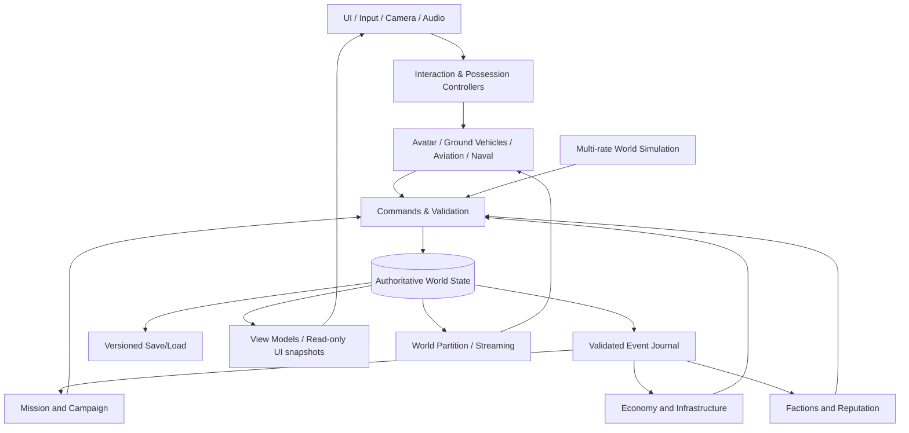
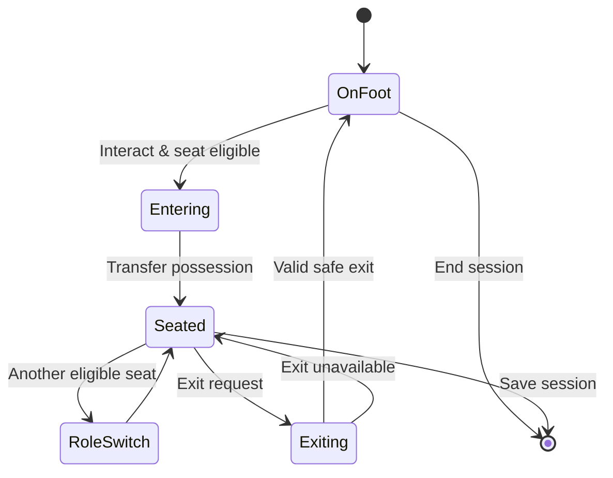

# EARTH FRONTIER — TECHNICAL ARCHITECTURE / TDD v0.1

## 1. Engine strategy

**Primary choice:** Unreal Engine 5, εφόσον το περιβάλλον ανάπτυξης παρέχει πράγματι την engine και δυνατότητα build/test. Προτείνεται για 3D μεγάλης κλίμακας, C++ gameplay, animation, scene streaming και υψηλή ποιότητα γραφικών. **Fallback μόνο μετά από απόφαση:** Godot 4.x για ελαφρύτερο playable prototype όταν ο διαθέσιμος εξοπλισμός/automation εμποδίζει τον UE5 κύκλο. Το project δεν διατηρεί δύο ασύμβατες engines ταυτόχρονα.

**Architecture-independent core:** event contracts, data schema, gameplay rules, missions, economy και save versioning να περιγράφονται χωρίς εξάρτηση από editor UI. Για UE5: Actors/Components για presentation και interaction, Subsystems για services, DataAssets/DataTables για περιεχόμενο, serializable structs για state. Για Godot: Nodes/Resources/Autoload managers ανά αντίστοιχη λειτουργία. Μην απαιτείς code που υλοποιεί και τις δύο επιλογές στην πρώτη φάση.

## 2. Layering



**Invariant:** το UI ποτέ δεν αποτελεί source of truth. Το world state αλλάζει με validated commands, καταγράφει events και δίνει snapshots σε άλλα συστήματα. Τα presentation actors μπορούν να επαναδημιουργηθούν χωρίς να σβηστούν τα persistent data.

## 3. Suggested folders (UE5-style)

```text
EarthFrontier/
├── Config/
├── Content/
│   ├── Core/
│   ├── Characters/
│   ├── Vehicles/Ground/
│   ├── Vehicles/Aviation/
│   ├── Vehicles/Naval/
│   ├── World/Asterion/
│   ├── UI/
│   ├── Audio/
│   ├── FX/
│   └── Data/
│       ├── Factions/
│       ├── Missions/
│       ├── Vehicles/
│       ├── Economy/
│       └── Localization/
├── Source/EarthFrontier/
│   ├── Core/
│   ├── WorldSimulation/
│   ├── WorldState/
│   ├── Interaction/
│   ├── Player/
│   ├── Vehicles/
│   │   ├── Common/
│   │   ├── Ground/
│   │   ├── Aviation/
│   │   └── Naval/
│   ├── AI/
│   ├── Missions/
│   ├── Campaign/
│   ├── Factions/
│   ├── Economy/
│   ├── Save/
│   ├── UI/
│   └── DevTools/
├── Tests/
├── Docs/
├── Tools/
└── README.md
```

## 4. Domain modules and ownership

| Module | Owns | Reads | Publishes |
|---|---|---|---|
| EntityRegistry | stable IDs, entity metadata | world profile | EntityRegistered |
| PlayerProfile | career, inventory, currency | mission rewards | PlayerUpdated |
| Possession | current avatar/vehicle/seat | player, seat definitions | RoleChanged |
| WorldClock | world tick, calendar | no gameplay mutation | WorldTick |
| Weather | region weather | clock, seeded presets | WeatherChanged |
| RegionState | control/stability/infrastructure refs | faction/economy outcomes | RegionUpdated |
| Vehicles | persistent condition, ownership | vehicle data, world | VehicleConditionChanged |
| Missions | objective graph/progress | entities/events | MissionCompleted |
| Economy | node stocks/prices | port/infrastructure | ResourceStockChanged |
| Factions | reputation/relations | world/mission events | FactionReputationChanged |
| Campaign | flags, acts, branches | mission/world events | CampaignFlagChanged |
| SaveService | serialized snapshots/journal | all domain states | SaveCompleted |
| UI | presentation only | view-model snapshots | user commands only |

Αποφύγετε cyclic dependencies: π.χ. Missions → WorldCommandBus → Economy και Economy → WorldEventBus → Mission notifications, όχι Missions ↔ Economy με άμεσες αμφίδρομες κλήσεις.

## 5. Player / vehicles state machine



Important: saving while seated should preserve seat ID and vehicle ID; on load validate assets/world placement and fall back to valid spawn when needed.

## 6. Stable IDs and serializable data

Use IDs such as `player_main`, `region_asterion_west`, `vehicle_helo_001`, `faction_commonwealth`, `mission_relief_001`; create runtime unique IDs via a stable UUID algorithm. Avoid using transient pointers or actor array indices in save files. Model snapshots with explicit `schema_version`, migration function and `last_simulated_tick`.

### Example serializable vehicle state

```json
{
  "schema_version": 1,
  "entity_id": "vehicle_helo_001",
  "definition_id": "helo_light_01",
  "region_id": "region_asterion_west",
  "pose": {"position": [120.0, 34.0, 0.0], "rotation": [0.0, 0.0, 0.0]},
  "condition_normalized": 0.96,
  "cargo_items": [{"item_id": "water_pack", "quantity": 8}],
  "occupied_seats": [{"seat_id": "pilot", "occupant_entity_id": "player_main"}]
}
```

Οι αριθμητικές τιμές είναι αυθαίρετα δεδομένα παιχνιδιού και **όχι** αναφορές σε υπαρκτά μέσα.

## 7. Event envelope + command validation

**Command:** action, actor, target, game-state preconditions, request ID, data. **Event:** unique event ID, monotonic world tick, schema version, source ID, payload. Τα commands μπορούν να απορριφθούν με σαφή reason χωρίς να αλλοιώσουν world state. Τα events είναι idempotent on replay και αναπαράγουν τις αλλαγές μέσω versioned reducers όπου ενδείκνυται.

```json
{
  "event_id": "evt_0001042",
  "schema_version": 1,
  "event_type": "CivilianReliefDelivered",
  "occurred_at_world_tick": 8742,
  "source_entity_id": "player_main",
  "region_id": "region_asterion_west",
  "payload": {"item_id": "water_pack", "quantity": 8, "mission_id": "mission_relief_001"}
}
```

Atomic transaction should apply stock delta once, update mission state/reputation and emit derived news event once, preserving an audit log.

## 8. World simulation scheduling

- Full local entities: fixed gameplay tick.
- Regional entities: periodic simplified updates and queue-derived state.
- Remote regions: coarse economic/political stochastic update with deterministic seeds.
- Catch-up after load: bounded and predictable tick advancement, avoiding huge single-frame work.
- Per-system budgets: instrument CPU time and entity count.

**No remote full fidelity:** NPC animations, vehicle detailed physics, collision proxies and 3D audio only within active streaming radius. A far-away commercial transport may be recorded as an ETA and cargo transfer event.

## 9. Graphics / world streaming

Use world partition, spatial layers (ground/sea/air), HLOD, terrain streaming, instancing vegetation, occlusion, sound culling, density scaling. At water transitions maintain stable entity coordinates and sea state; near high altitude use world origin rebasing or engine-supported large world coordinates. `WorldRegionID` must not depend on streaming chunk identity.

## 10. Input architecture

`InputAction` IDs: `Move`, `Look`, `Interact`, `EnterExitVehicle`, `SwitchCamera`, `Accelerate`, `Brake`, `Steer`, `VehicleRoleAction`, `MissionJournal`, `WorldMap`, `Pause`. Role-specific profiles can map extra abstract videogame axes. Never hardcode hardware codes inside vehicle actor implementations.

## 11. UI architecture

Command/query separation: UI requests validated command (e.g. AcceptMission), domain handles mutation, UI observes state projection. Role-specific HUDs are swappable components that share common credits, mission, world clock and news view-models.

## 12. Save / persistence strategy

- Save slot metadata: name, playtime, schema version, timestamp.
- Snapshot: authoritative player/region/vehicle/economy/mission/faction/campaign state.
- Journal: applied event IDs, world tick/seed.
- Atomic writes and backup.
- Migration tables and forward/backward compatibility policy.
- Reconstruct active presentation entities from snapshot.
- Validate missing/unavailable asset IDs with placeholders and warnings.

## 13. Testing strategy

**Unit:** event validation, reputation bounds, economy stock, mission graph, seat eligibility.  
**Integration:** mission → stock → reputation → news, seat switch → save/load, world tick → economy.  
**Smoke:** game boots, UI available, one NPC interaction, one vehicle enter/exit, one mission delivered.  
**Performance:** counts of active NPC, actors, streaming transitions, FPS distribution per target tier.  
**Safety/content:** ensure simulated map/mission content is wholly fictional and non-graphic.

## 14. Key architectural decisions

1. Single-player first; do not design netcode as an assumed requirement.
2. Vehicles are modular gameplay entities with common possession/input/camera interfaces.
3. Mission graphs trigger authoritative commands, not ad-hoc UI updates.
4. Physical representation is local; global world remains data-driven.
5. One save schema, one world clock, one economy, one reputation ledger.
6. Story beats query world state and cannot silently overwrite conflicting facts.
7. Engine integration follows clean interfaces; compiler and runtime success must be tested, not assumed.
