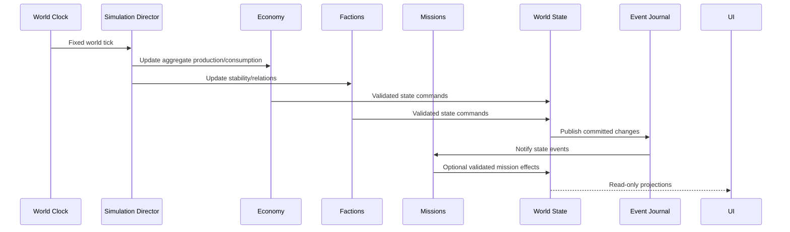
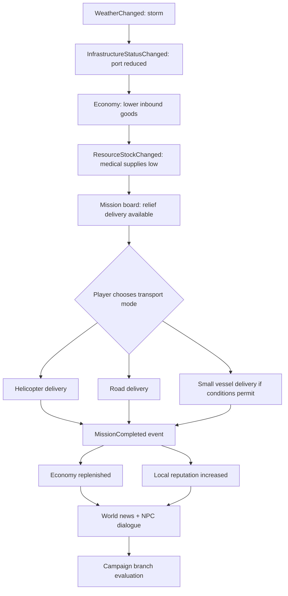

# EARTH FRONTIER — WORLD SIMULATION & SYSTEM INTEGRATION
## Προδιαγραφή ενιαίου, δυναμικού, persistent κόσμου

## 1. Το συμβόλαιο του World State

Ο κόσμος είναι ένα σύνολο **authoritative domain states**: `WorldTime`, `RegionState`, `FactionState`, `EconomyState`, `MissionState`, `CampaignState`, `PlayerState`, `VehicleState`, `NPCState`. Τα visual actors είναι προβολές αυτών των states. Ο renderer δεν αποφασίζει αν μια κοινότητα έχει προμήθειες, αν μια αποστολή ολοκληρώθηκε ή ποια παράταξη ελέγχει μια περιοχή.

**Απαράβατα invariants:**

- Για κάθε persistent entity υπάρχει ένα μοναδικό stable ID.
- Για κάθε mutable πεδίο υπάρχει μοναδικός domain owner.
- Mutations περνούν από validated commands.
- Τα accepted commands οδηγούν σε events με μοναδικά IDs.
- Save/load ανακτά τα invariants, όχι μόνο την εικόνα της σκηνής.
- Το UI ποτέ δεν χρησιμοποιείται ως πηγή αλήθειας.
- Offscreen world progression ακολουθεί ρυθμούς που δεν εξαρτώνται από FPS.
- Αλλαγή ρόλου μεταβάλλει μόνο τον controller, την κάμερα και επιτρεπτά role permissions — δεν επανεκκινεί το timeline.

## 2. Κύκλος ενημέρωσης simulation



**Tick tiers (design defaults, subject to testing):**

- Tier L: local movement/interaction driven by the engine fixed simulation step.
- Tier R: regional decisions every configurable number of world ticks.
- Tier G: global economy/politics aggregated on longer intervals.

These are *game simulation intervals*, not real-world operational timelines. Implement catch-up with bounded updates to avoid freezes after loading a long-running save.

## 3. Domain data outline

| Domain | Example state | Source-of-truth owner |
|---|---|---|
| Player | credits, qualifications, reputation references | Player service |
| Region | stability, control, weather zone, population index | Region service |
| Faction | reputation ledger, relations, aggregate resources | Faction service |
| Economy | stock, consumption, node capacity, service availability | Economy service |
| Vehicles | ownership, condition, cargo, seat occupancy, transform | Vehicle service |
| Missions | objective graph, progress, decisions, outcomes | Mission service |
| Campaign | act, plot flags, NPC story relations | Campaign service |
| NPC | identity, task, occupation, relationship | NPC service |
| Clock/Weather | date, tick, weather condition/seeds | WorldClock / Weather service |

## 4. Sample mission to world-state chain

**Fictional event:** Το λιμάνι Harbor West διακόπτει προσωρινά τη λειτουργία του λόγω κακοκαιρίας.



**Design point:** το ίδιο mission state δέχεται διαφορετικές δραστηριότητες όταν είναι εφικτές και επιτρέπεται gameplay-wise, αλλά τα effects στον κόσμο είναι συνεπή.

## 5. Event envelope

```json
{
  "event_id": "evt_00120",
  "event_type": "InfrastructureStatusChanged",
  "schema_version": 1,
  "occurred_at_world_tick": 9200,
  "region_id": "region_harbor_west",
  "source_entity_id": "system_weather",
  "payload": {
    "infrastructure_id": "port_harbor_west",
    "previous_status": "operational",
    "new_status": "restricted",
    "reason_tag": "weather_gameplay_event"
  }
}
```

**Event consumer contract:** Validate `event_type`, `schema_version`, `source`, and nonnegative world tick; reject malformed event; deduplicate `event_id`; apply if prerequisites hold; record derivative event IDs. Have a strict policy for unexpected events to avoid save corruption.

## 6. Mission transaction — example

1. Player interact submits `CompleteDelivery(mission_id, goods, quantity)`.
2. Mission module validates objective is active and delivery not previously credited.
3. Economy validates destination and accepts stock increment.
4. Transaction commits reward, economy update, mission completion and reputation delta.
5. Journal receives committed event IDs.
6. News notification created from source event reference.
7. UI refreshes from state projection.
8. Save/load replays without double credit.

If one substep fails, the transaction must roll back or be designed for idempotent repair. No partial silent updates.

## 7. Regional conflicts — non-operational abstraction

Represent changing conflict influence only with fictional balancing variables such as regional stability, public support, resource availability, aggregate capability, diplomacy and story pressure. Use clear game rules and telemetry. Avoid modelling real-world target selection, vulnerabilities, actionable attack planning or authentic military force optimization.

Results can include control shift, availability of transport corridors, changed public services, dialogues, refugee-relief missions and news items. A conflict never requires graphically violent presentation to signal an important consequence.

## 8. Economy equations (game-balanced, non-realistic)

A simple stock update is sufficient for the first version:

`stock_next = clamp(stock + production - consumption + inbound - outbound, 0, capacity)`

A normalized shortage signal:

`shortage = clamp((target_stock - stock) / max(target_stock, 1), 0, 1)`

Example price hint for game economy:

`price = base_price * (1 + shortage_weight * shortage)`

These are **fictional game formulas**, not economic forecasts. Apply caps/smoothing to avoid instability, UI explanation for price changes and tests for no-negative-stock conditions.

## 9. Reputation propagation

A mission may apply multiple explicit deltas: faction reputation, local community trust, career progression. Use event provenance to make it explainable. Example: `+6` local trust from completed relief and `+2` toward neutral relief network. No invisible unrelated changes. Reputation should clamp to valid domain range.

## 10. Persistent player role across levels

Player entity stable across scene streaming. Vehicle entity persists even when streamed out. Streaming unload should:

- Capture persistent transform/state if necessary.
- Destroy only presentation actors (not domain state).
- Preserve active mission references to stable IDs.
- Restore camera/input state when a relevant actor returns.
- Recover gracefully when target entity is temporarily unavailable.

## 11. Simulation observability

Developer UI/debug must show:

- Active simulation tier and tick.
- Actor/vehicle/NPC counts.
- Region stock/stability/control.
- Current player entity, possessed vehicle and seat ID.
- Last 20 committed world events.
- Mission progress and authoritative rewards.
- Save schema version and replay status.
- CPU/streaming timings where measurable.

Do not rely only on visual impressions when determining whether systems are connected.

## 12. Determinism and reproducibility

- Each region has a deterministic seed for procedurally created content.
- Derived randomness uses named stream IDs and recorded seeds.
- Test simulations can run in headless mode or through deterministic mock drivers.
- A fixed input sequence should give equivalent domain results across runs in the same build/schema.
- Serialized floats and platform differences require defined tolerances.

## 13. Test scenarios

| Test ID | Scenario | Expected result |
|---|---|---|
| WS-01 | Two identical event IDs | Effect applied once |
| WS-02 | Player changes from foot to helicopter | Mission, credits and world tick unchanged |
| WS-03 | Region streaming unload/load | Economy/control state preserved |
| WS-04 | Complete delivery, save/load | No duplicate reward/stock |
| WS-05 | Weather restricts a port | Dependent mission availability updates |
| WS-06 | No player near remote region | Aggregate regional world progresses |
| WS-07 | Local reputation improves | Correct dialogue/shop options become available |
| WS-08 | NPC removed from visual stream | NPC persistent story/state remains |
| WS-09 | Missing optional asset after patch | Safe fallback and logged warning |
| WS-10 | Mission denied by failed prerequisites | No state mutation |

## 14. Example dynamic campaign beat

After several independent changes to economic stability, regional reputation and mediation progress, the campaign director offers one of three story chapters: cooperative recovery, uneasy ceasefire or prolonged political disagreement. No fixed pre-selected ending: story choices and world state both matter. The campaign director cannot rewrite economy or reputation directly; it submits validated domain commands.
